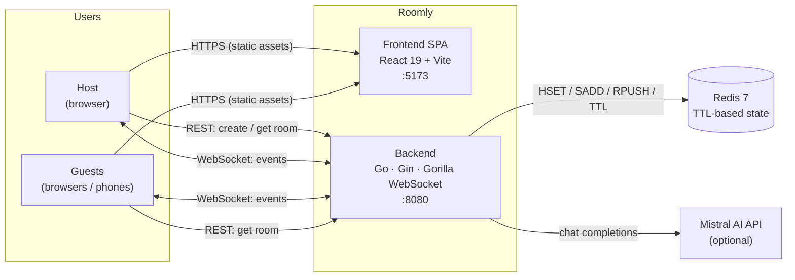
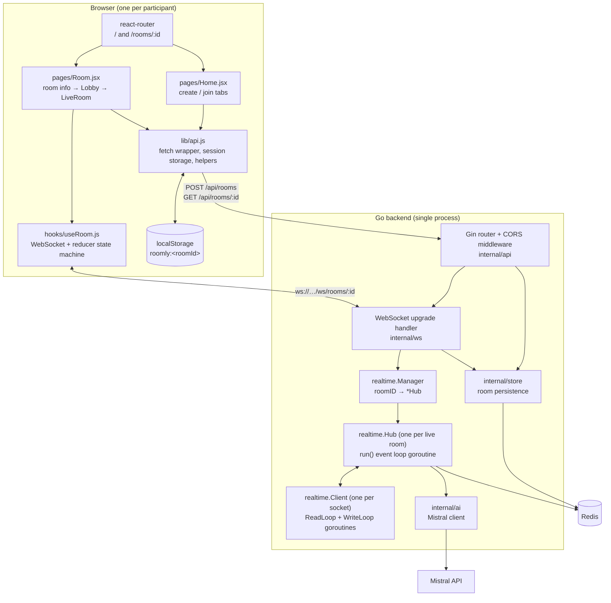
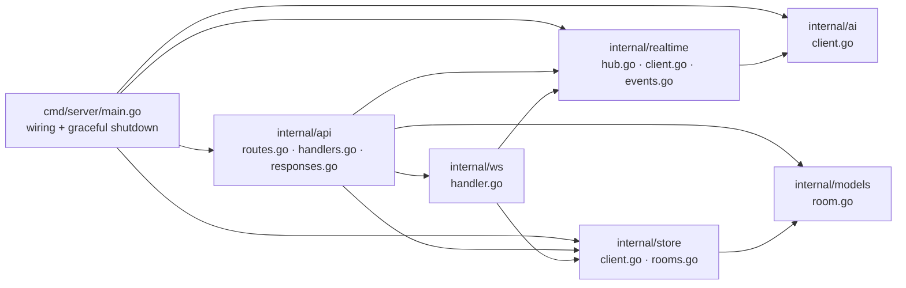
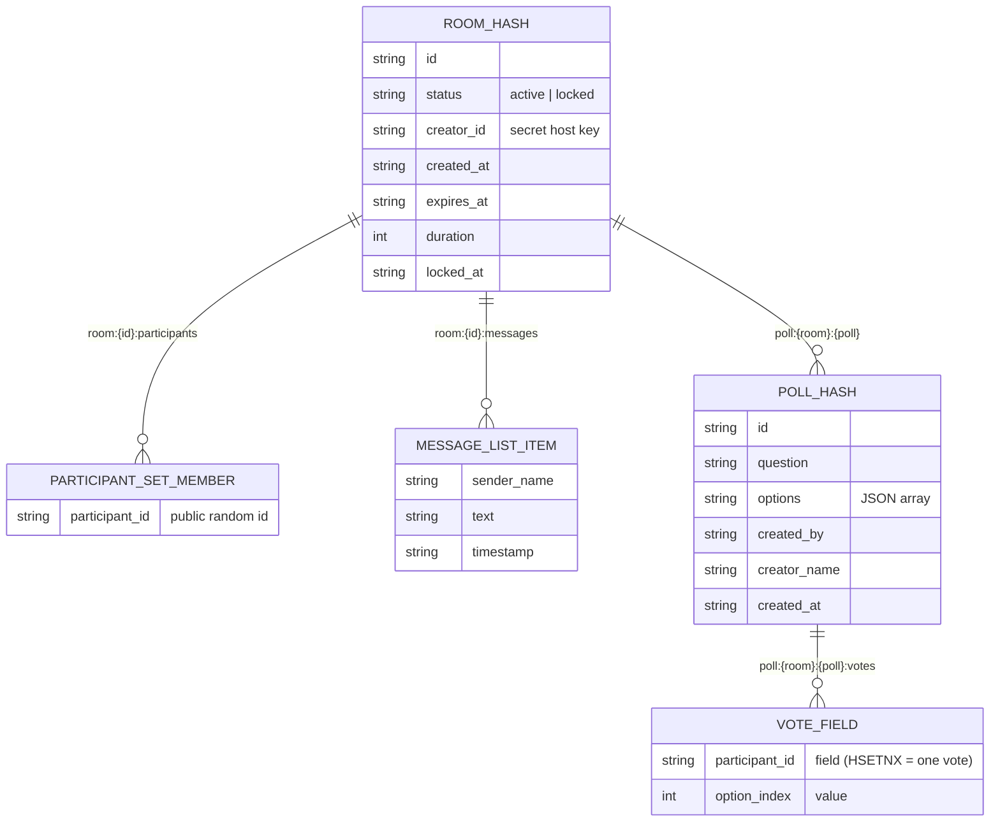
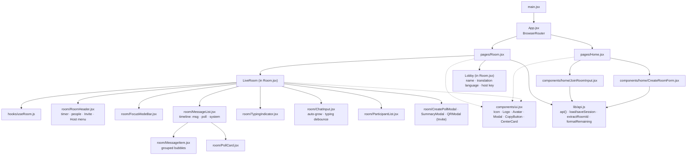
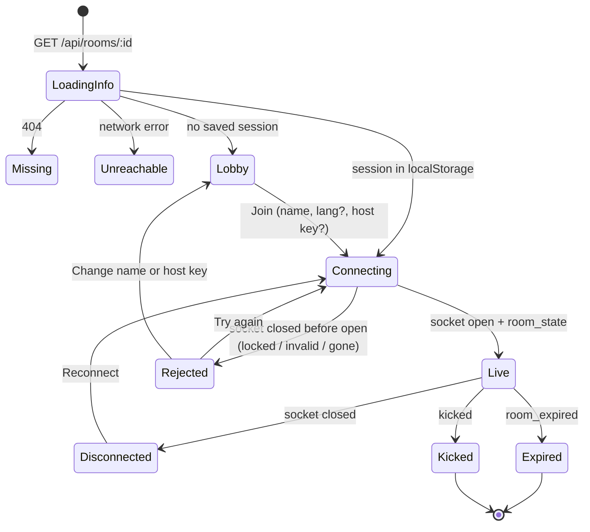
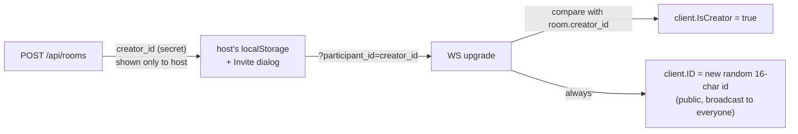

# Roomly — Architecture

> Ephemeral, real-time chat rooms. No accounts, no database rows that outlive the room.
> A room is created with a lifespan (15 min – 2 h); when the timer ends, everything in it is deleted.

| Document | What it covers |
|---|---|
| **ARCHITECTURE.md** (this file) | What Roomly is, the system map, every module on the client and the server, how data is stored |
| [REALTIME.md](./REALTIME.md) | WebSocket deep dive — handshake, Hub/Client model, the read loop and write loop, channels, locking, the event protocol |
| [FLOWS.md](./FLOWS.md) | Step-by-step sequence diagrams for every user journey (create, join, chat, polls, focus mode, AI recap, lock, kick, expiry) |

---

## 1. What the product does

| Capability | How it works for the user |
|---|---|
| **Timed rooms** | Host picks 15 / 30 / 60 / 120 minutes. A countdown shows in every client. At zero the room self-destructs. |
| **No accounts** | You type a display name. The host gets a secret **host key** that unlocks host controls. |
| **Share** | Link, room code, or QR code (generated by the server as a PNG data URL). |
| **Chat** | Real-time messages over a WebSocket, typing indicators, join/leave notices. |
| **Polls** | Anyone can post a 2–5 option poll; one vote per participant, live tallies. |
| **Focus mode** | "Talking stick": while on, only the floor holder may send messages. Host can grant the floor. |
| **Host controls** | Lock room (no new joiners), remove a participant, toggle focus mode, request an AI recap. |
| **AI features** (optional) | Mistral-powered recap (TL;DR, decisions, action items, sentiment) and live per-reader translation. |

---

## 2. System context

**Two channels of communication:**

1. **REST (request/response)** — only for things that happen *outside* a live room: creating a room, reading room metadata for the lobby, and an HTTP fallback for locking.
2. **WebSocket (bidirectional, long-lived)** — everything that happens *inside* a room. One socket per browser tab; the server pushes events to every member.

---

## 3. Container view

---

## 4. Backend — package by package

| Package | Responsibility | Key types / functions |
|---|---|---|
| `cmd/server` | Reads env (`PORT`, `REDIS_URL`, `FRONTEND_URL`, `MISTRAL_API_KEY`), builds Redis + AI clients, the realtime `Manager`, and the Gin router. Handles `SIGINT/SIGTERM` with a 10 s graceful shutdown. | `main()` |
| `internal/api` | HTTP surface. CORS middleware (single allowed origin = `FRONTEND_URL`). Room creation generates IDs with `crypto/rand`, saves to Redis, renders a QR PNG. | `RegisterRoutes`, `Handler.CreateRoom`, `GetRoom`, `LockRoom` |
| `internal/ws` | Validates the join request (name length, room exists, room not locked unless host), upgrades HTTP → WebSocket, decides `isCreator`, builds a `Client`, registers it with the room's `Hub`, starts its two goroutines. | `Handler.ServeWS` |
| `internal/realtime` | The live room engine. `Manager` owns hubs; `Hub` owns clients, focus state, polls, timers; `Client` owns one socket. All event types and payloads live in `events.go`. | `Manager`, `Hub`, `Client`, `Event`, `*Payload` |
| `internal/store` | Thin Redis persistence for the room record (hash with TTL = lifespan). | `SaveRoom`, `GetRoom`, `LockRoom` |
| `internal/ai` | Mistral chat-completions client. `Summarize` uses `mistral-large-latest` and returns structured JSON; `Translate` uses `mistral-small-latest`. Disabled when no key. | `Client.Enabled`, `Summarize`, `Translate` |
| `internal/models` | Pure domain struct shared by all layers (no infra imports → no import cycles). | `models.Room` |

### HTTP API

| Method | Path | Purpose | Response |
|---|---|---|---|
| `GET` | `/health` | Liveness | `{status:"ok"}` |
| `POST` | `/api/rooms` | Create room `{display_name, duration_minutes}` | `{room_id, creator_id, link, expires_at, qr_code}` |
| `GET` | `/api/rooms/:id` | Lobby metadata | `{id, status, created_at, expires_at, locked, participant_count}` |
| `POST` | `/api/rooms/:id/lock` | HTTP fallback to lock `{creator_id}` | `{status:"locked", locked_at}` |
| `GET` | `/ws/rooms/:id?display_name=&participant_id=&lang=` | Upgrade to WebSocket | 101 Switching Protocols |

---

## 5. Data model — everything lives in Redis

Roomly deliberately has **no SQL database**. Every key is scoped to a room and expires with it.

| Key | Type | Written by | TTL / lifetime |
|---|---|---|---|
| `room:{id}` | Hash | `store.SaveRoom` on create; `LockRoom` | **TTL = room lifespan** — this TTL *is* the self-destruct timer |
| `room:{id}:participants` | Set | `Hub.trackParticipant` on join/leave | Mirrors live sockets (used for the lobby's "N here now") |
| `room:{id}:messages` | List | `Hub.storeMessage` — **only when AI is enabled** | 24 h, used as summary input |
| `poll:{room}:{poll}` | Hash | `Hub.SavePoll` | Room-scoped |
| `poll:{room}:{poll}:votes` | Hash | `Hub.RecordVote` via `HSETNX` | Room-scoped; `HSETNX` guarantees one vote per participant atomically |

> **In-memory state** (not in Redis): the connected `Client` map, focus mode / floor holder, and an in-memory poll index used for snapshots and option validation. A room's live state therefore belongs to **one backend process** — see *Scaling* below.

---

## 6. Frontend — module by module

### Room page state machine

### Client state (`useRoom` reducer)

| Field | Source event(s) |
|---|---|
| `connection` | `OPEN` / `CLOSED` (socket lifecycle; closed-before-open ⇒ `rejected`) |
| `selfId`, `isCreator`, `aiEnabled` | `room_state` |
| `participants` | `room_state`, `user_joined`, `user_left` |
| `timeline` (messages, polls, system notes) | `message`, `poll_created`, `user_joined/left`, `room_locked`, `focus_*` |
| `polls`, `myVotes` | `poll_created`, `poll_updated`, local `VOTE` |
| `typing` | `typing_started`, `typing_stopped`, `message` (clears sender) |
| `focus` | `focus_mode_enabled/disabled`, `floor_granted/released` |
| `roomStatus` | `room_locked`, `room_expired`, `kicked` |
| `summary` | `room_summary` |
| `serverError` | `error` (auto-dismissed after 5 s) |

---

## 7. Identity & trust model

* The **host key** (`creator_id`) is a 16-char `crypto/rand` secret. It is sent only once (create response) and is **never broadcast**.
* Every connection gets a **fresh public participant ID**. Permissions are checked with `client.IsCreator`, never by comparing IDs — so knowing someone's public ID grants nothing.
* Locked rooms reject new sockets at upgrade time unless the host key is presented.

---

## 8. Configuration

| Variable | Default | Used by |
|---|---|---|
| `PORT` | `8080` | Go server |
| `REDIS_URL` | `localhost:6379` | `store.NewClient` (fatal if unreachable) |
| `FRONTEND_URL` | `http://localhost:5173` | CORS origin, join links, QR codes |
| `MISTRAL_API_KEY` | empty | Enables AI recap + translation |
| `VITE_API_URL` | `http://localhost:8080` | Frontend REST base |
| `VITE_WS_URL` | derived from API URL | Frontend WebSocket base |

---

## 9. Scaling notes & limits

* **Single-process rooms.** A `Hub` lives in one Go process. To run several backend replicas you need either **sticky routing by room ID** at the load balancer, or a **Redis Pub/Sub fan-out** so each process relays room events to its own sockets.
* **Bounded send buffers.** Each client has a 256-message buffered channel; a client that can't keep up has messages dropped rather than blocking the room (see REALTIME.md §5).
* **Origin check.** `CheckOrigin` currently allows all origins for the WebSocket upgrade; restrict it to `FRONTEND_URL` in production.
* **Poll keys** don't carry a TTL; add `EXPIRE` alongside the room TTL if Redis memory matters.
