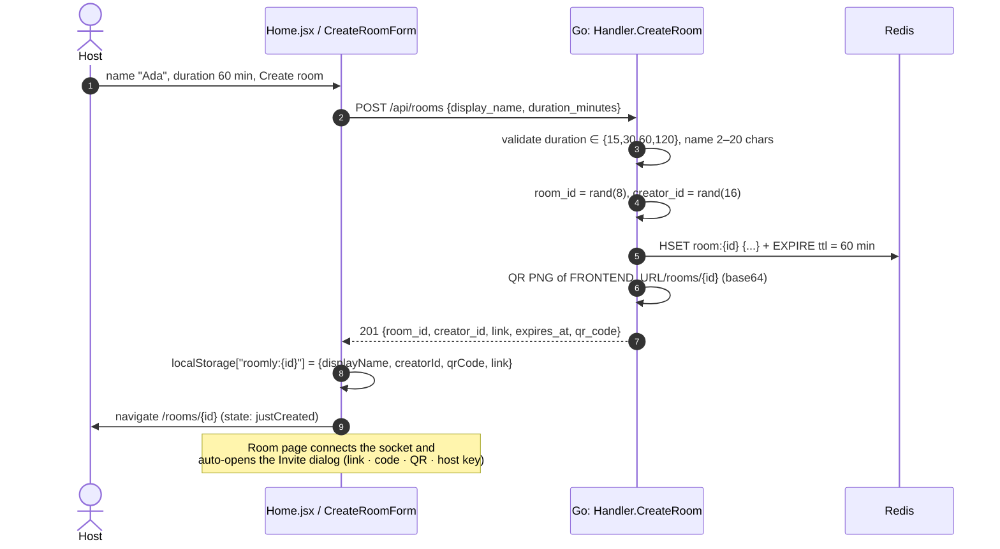
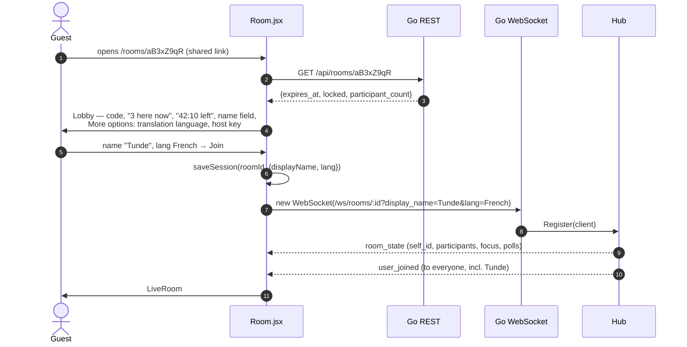
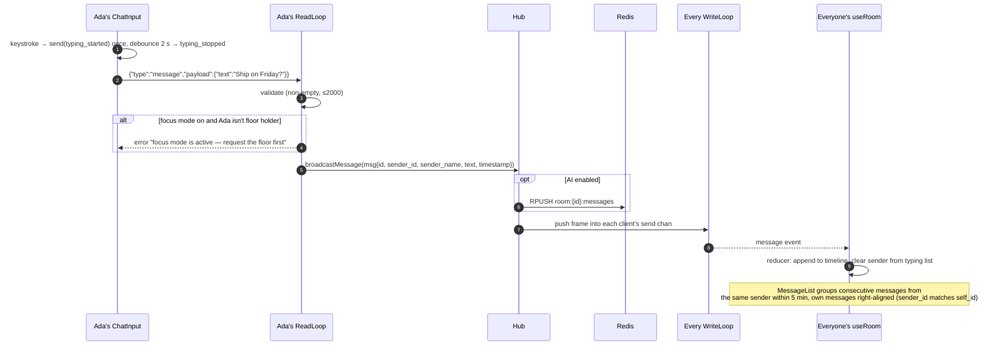
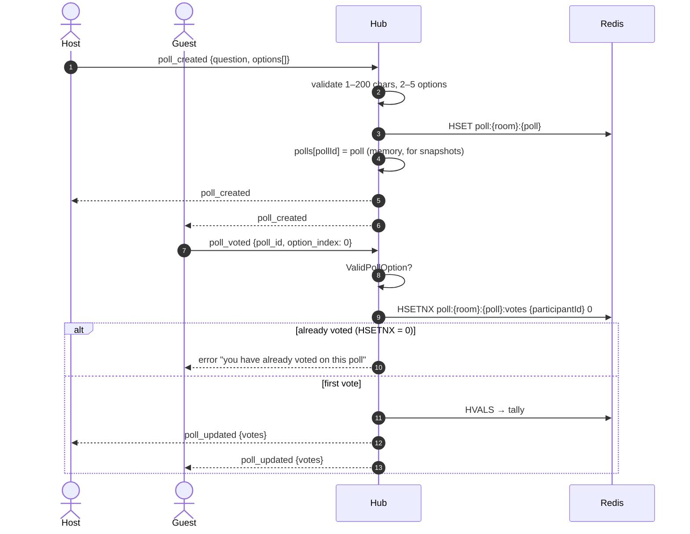
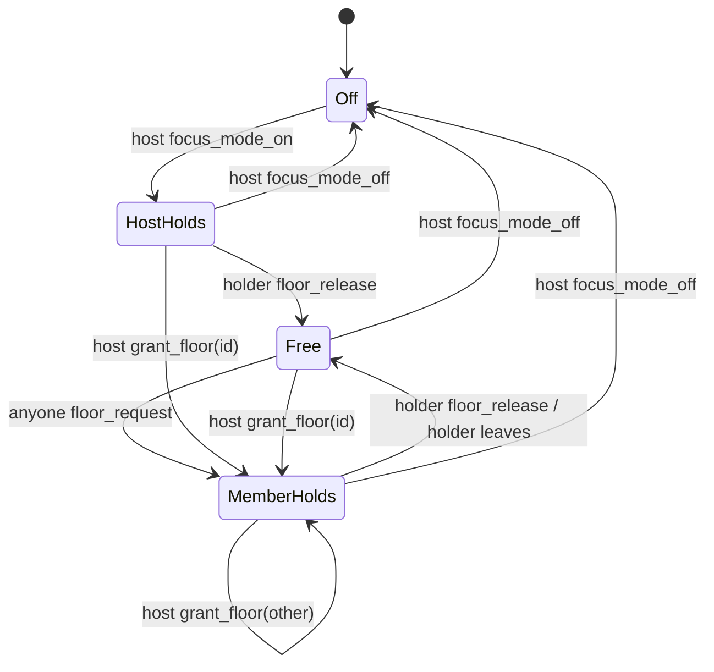
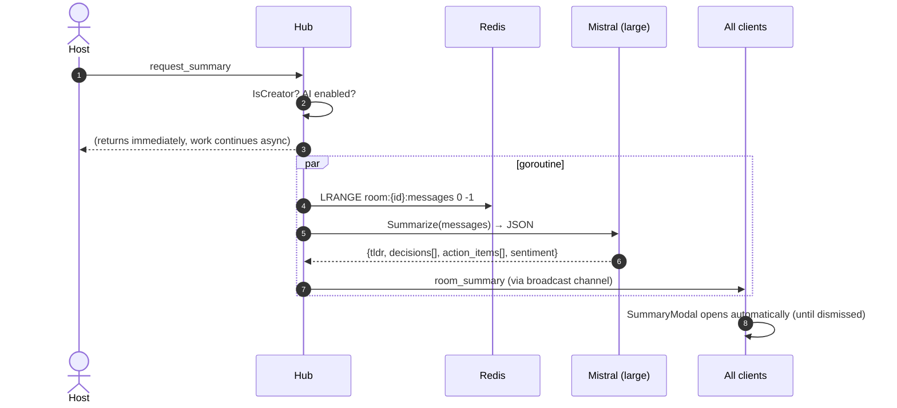
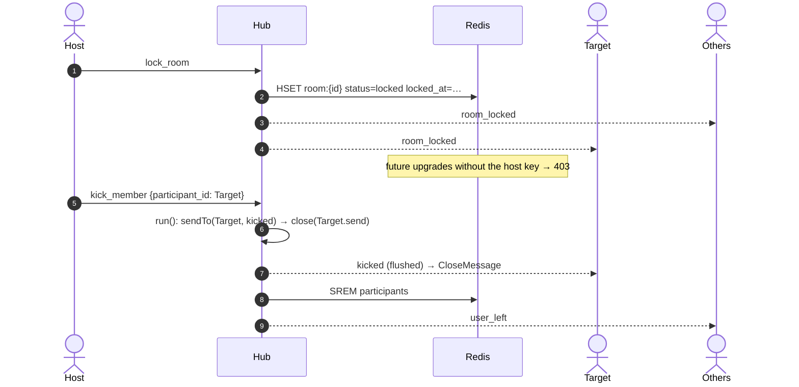
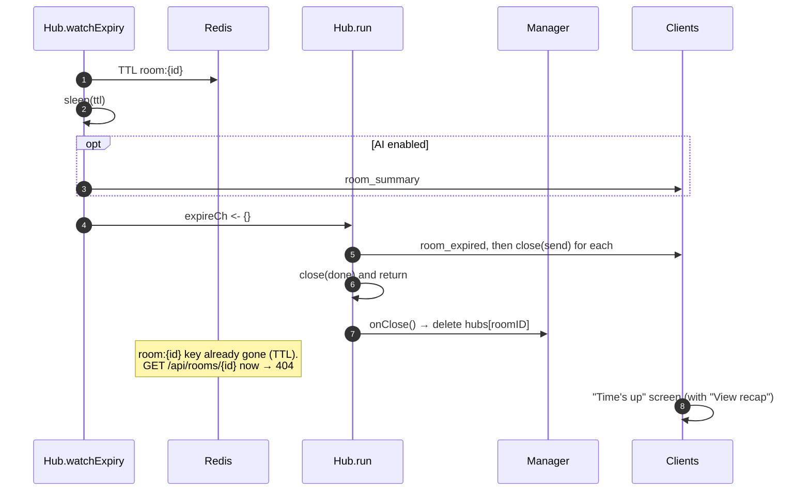

# Roomly — Request Flows

Each diagram follows a request from the browser to Redis and back. See [ARCHITECTURE.md](./ARCHITECTURE.md) for the system map and [REALTIME.md](./REALTIME.md) for socket internals.

---

## 1. Create a room

---

## 2. Join a room (guest)

Error branches: **404** → "This room doesn't exist"; **locked** without host key → lobby insists on the host key; socket refused → "Couldn't join this room".

---

## 3. Send a chat message

---

## 4. Polls

---

## 5. Focus mode (talking stick)

While focus mode is on, `handleChat` rejects messages from anyone who isn't the floor holder; the composer is disabled client-side with "X has the floor".

---

## 6. AI recap

The same summary is generated automatically just before expiry, so the recap is the last thing people see.

---

## 7. Lock & kick

---

## 8. Expiry (self-destruct)

Client-side, the header countdown is computed from `expires_at` (fetched once) so it keeps ticking even if the socket drops; under 5 minutes it turns solid orange.
