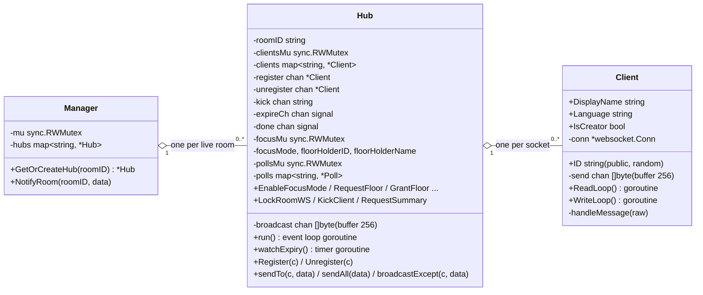
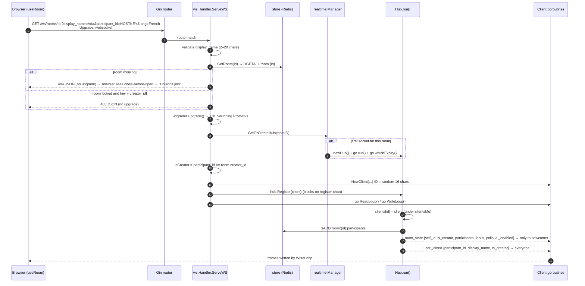
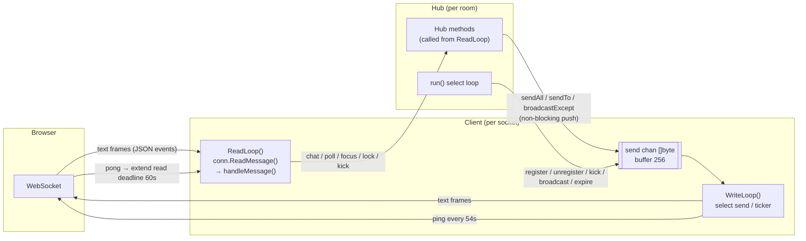
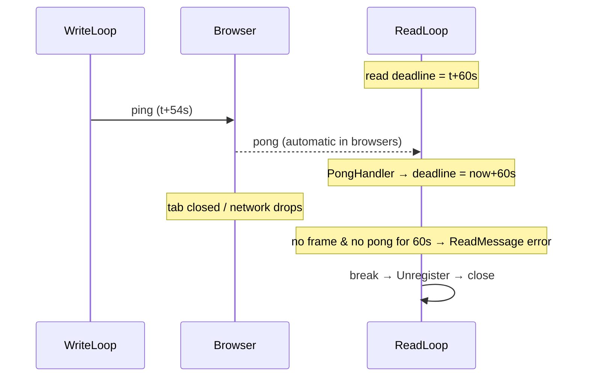
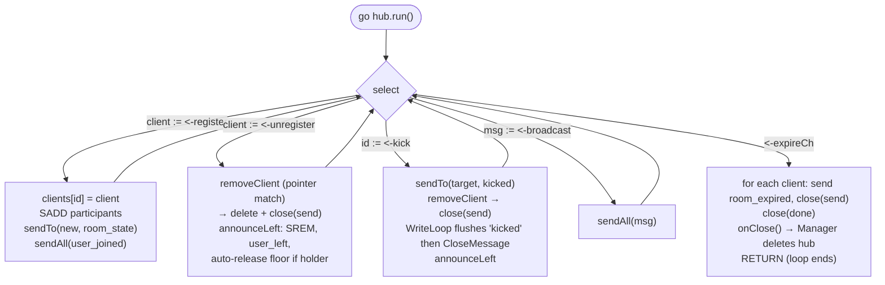
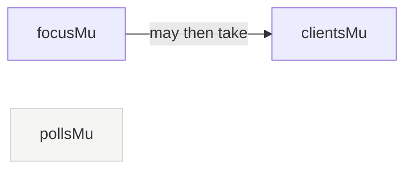
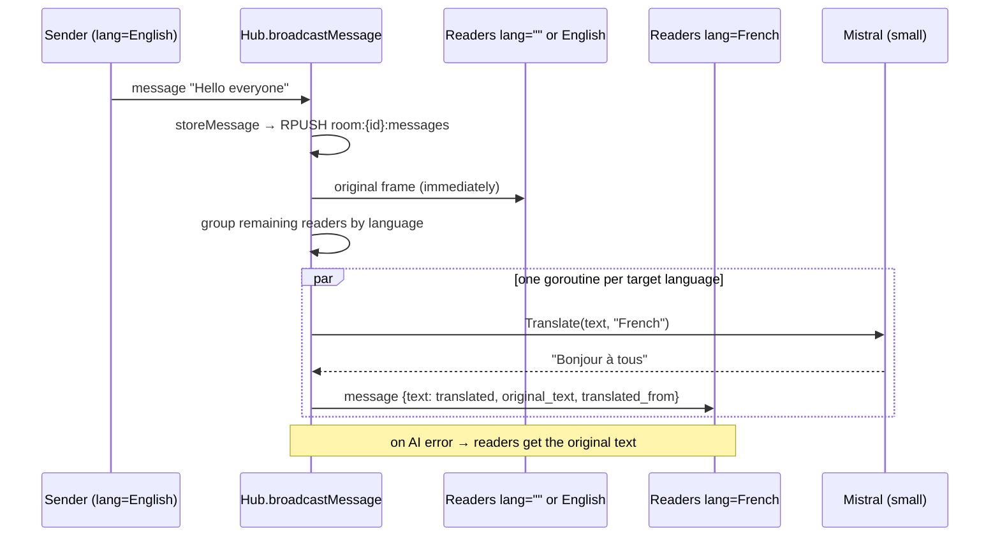
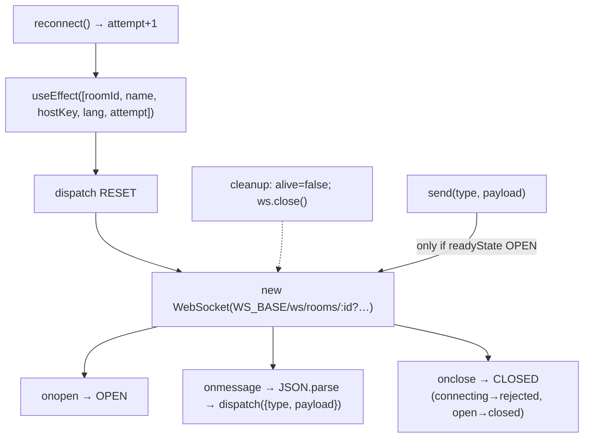

# Roomly — Real-time Engine (WebSockets)

This is the heart of Roomly. Every in-room action — a chat message, a vote, the host locking the room — travels over a single WebSocket per participant and is fanned out by a per-room **Hub**.

Source: `backend/internal/ws/handler.go`, `backend/internal/realtime/{hub,client,events}.go`, `frontend/src/hooks/useRoom.js`.

---

## 1. The three actors



| Actor | Lifetime | Goroutines |
|---|---|---|
| `Manager` | Whole process | none (just a mutex-guarded map) |
| `Hub` | From the first socket into a room until the room expires | `run()` (event loop) + `watchExpiry()` (timer) |
| `Client` | One WebSocket connection | `ReadLoop()` + `WriteLoop()` |

So a room with **N** participants runs **2 + 2N** goroutines.

---

## 2. Connecting: from HTTP request to live socket



**Why `room_state` first?** Late joiners would otherwise see an empty room: `user_joined` is only broadcast for *new* arrivals. The snapshot gives the newcomer its own public ID (`self_id`, used to align "my" messages to the right), the current participant list, focus mode, and existing polls with live tallies.

---

## 3. The read loop and the write loop

Each socket has exactly **one reader** and **one writer** — Gorilla WebSocket connections are not safe for concurrent writes, so *all* writes for a connection funnel through its `send` channel into `WriteLoop`.



### ReadLoop (`client.go`)

```text
defer: hub.Unregister(c); conn.Close()
SetReadLimit(10 KB)                      ← oversized frames kill the socket
SetReadDeadline(now + 60s)               ← pongWait
SetPongHandler(extend deadline 60s)
loop:
    _, raw, err := conn.ReadMessage()    ← blocks
    if err → break (client gone / deadline passed / limit exceeded)
    handleMessage(raw)                   ← parse {type, payload}; dispatch
```

### WriteLoop (`client.go`)

```text
ticker := every 54s                      ← pingPeriod = pongWait * 9/10
loop select:
  case msg, ok := <-send:
      SetWriteDeadline(now + 10s)
      if !ok → write CloseMessage; return   ← channel closed by hub = "you're done"
      WriteMessage(TextMessage, msg)        ← error → return
  case <-ticker:
      WriteMessage(PingMessage)             ← error → return
defer: ticker.Stop(); conn.Close()
```

### Keep-alive timeline



A dead peer is therefore detected in **at most ~60 seconds**, even if TCP never reports the drop.

---

## 4. The Hub event loop

`Hub.run()` is the single place that **adds and removes** clients. Everything that changes room membership flows through its channels, so membership changes are serialised.



### Who writes to which channel

| Channel | Producer | Notes |
|---|---|---|
| `register` | `ws.Handler` via `hub.Register(c)` | If the hub already finished (`done` closed), the client's `send` is closed immediately so its WriteLoop exits. |
| `unregister` | `Client.ReadLoop` defer | `select` with `done` so a dead hub never blocks a reader. |
| `kick` | `Client.handleKickMember` → `Hub.KickClient` (host only) | |
| `broadcast` (buffered 256) | `Hub.Notify` — polls, summaries, HTTP-lock fallback via `Manager.NotifyRoom` | Non-blocking: dropped if the buffer is full. |
| `expireCh` (buffered 1) | `Hub.watchExpiry` when the Redis TTL elapses | Generates the AI summary *before* expiring, so clients receive `room_summary` then `room_expired`. |

### Fast paths that bypass `run()`

Chat messages, typing indicators and focus-mode changes are delivered **directly** from the sender's `ReadLoop` using `sendAll` / `broadcastExcept` under a **read lock** — they don't need to wait in the hub's queue. That's safe because:

* they only *read* the client map (`clientsMu.RLock`), and
* removal (`removeClient`) takes the *write* lock and closes `send` inside it — so nobody can ever push into a closed channel.

---

## 5. Concurrency & safety rules



| Rule | Why |
|---|---|
| **Lock order: `focusMu` → `clientsMu`**, never the reverse | `GrantFloor` reads `clients` then updates focus; consistent ordering prevents deadlock. `pollsMu` is never held while taking another lock. |
| **All socket writes go through `send`** | Gorilla allows one concurrent writer. |
| **Every push is non-blocking** (`select { case send <- x: default: }`) | One slow phone must never stall the room. If its 256-slot buffer is full, that client simply misses the message (it's not closed). |
| **Close `send` only while holding `clientsMu` (write)** and only after removing the client from the map | Guarantees no goroutine can send on a closed channel (which would panic). |
| **Pointer-match on removal** (`clients[id] == client`) | A stale socket's unregister can never evict a newer connection. |
| **`done` channel** | After expiry, `Register`, `Unregister` and `KickClient` return immediately instead of blocking forever on a hub that stopped reading. |
| **Expired hubs are removed from `Manager`** via `onClose` | No goroutine/memory leak per room. `GetOrCreateHub` also replaces a hub whose `done` is closed. |
| **Votes use `HSETNX`** | Atomic "one vote per participant" in Redis, even under concurrent clicks. |

---

## 6. The event protocol

Every frame, in both directions, is JSON:

```json
{ "type": "message", "payload": { "text": "hello" } }
```

### Client → Server

| `type` | Payload | Who may send | Server action |
|---|---|---|---|
| `message` | `{text}` ≤ 2000 chars | anyone; floor holder only during focus mode | store (if AI on), broadcast/translate `message` |
| `typing_started` / `typing_stopped` | — | anyone | `broadcastExcept` sender |
| `poll_created` | `{question, options[2..5]}` | anyone | save poll, broadcast `poll_created` |
| `poll_voted` | `{poll_id, option_index}` | anyone, once per poll | validate option, `HSETNX`, broadcast `poll_updated` |
| `lock_room` | — | host | `HSET status=locked`, broadcast `room_locked` |
| `kick_member` | `{participant_id}` | host | `kicked` to target, close, `user_left` to all |
| `focus_mode_on` / `focus_mode_off` | — | host | broadcast `focus_mode_enabled` (host holds floor) / `focus_mode_disabled` |
| `floor_request` / `floor_release` | — | anyone | `floor_granted` / `floor_released` |
| `grant_floor` | `{participant_id}` | host | `floor_granted` |
| `request_summary` | — | host, AI enabled | async summary → `room_summary` |

### Server → Client

| `type` | When |
|---|---|
| `room_state` | Once, right after connecting (to that client only) |
| `user_joined` / `user_left` | Membership changes |
| `message` | New chat message (possibly translated: `original_text`, `translated_from`) |
| `typing_started` / `typing_stopped` | Others typing |
| `poll_created` / `poll_updated` | Polls and live tallies |
| `focus_mode_enabled` / `focus_mode_disabled` / `floor_granted` / `floor_released` | Talking-stick changes |
| `room_locked` | Host locked the room |
| `room_summary` | AI recap (on request, and automatically before expiry) |
| `room_expired` | Timer ended — the socket closes right after |
| `kicked` | You were removed — the socket closes right after |
| `error` | A rejected action, e.g. "focus mode is active — request the floor first" |

---

## 7. Live translation fan-out



One translation call per **language**, not per reader. The sender always receives the original.

---

## 8. Frontend: `useRoom` hook



* **Single source of truth:** a `useReducer` whose action types are the server event names, so adding a server event = adding one `case`.
* **`alive` flag** ignores events from a socket that the effect already cleaned up (React StrictMode mounts effects twice in development).
* **Rejection detection:** if the socket closes *before* it ever opened, the server refused the upgrade (locked room, invalid name, room gone) and the UI shows "Couldn't join" instead of a reconnect banner.
* **Optimistic vote memory:** `send('poll_voted')` records `myVotes[pollId]` locally so the card switches to results immediately; the authoritative tally arrives as `poll_updated`.

---

## 9. Closing semantics (who closes what)

| Trigger | Server sequence | Client sees |
|---|---|---|
| Tab closed / network lost | ReadLoop errors → `Unregister` → `close(send)` → WriteLoop sends CloseMessage & exits | — |
| Host kicks someone | `kicked` queued → `close(send)` → WriteLoop flushes `kicked`, then CloseMessage | "You were removed" screen |
| Room expires | `room_summary` (if AI) → `room_expired` to all → `close(send)` for all → hub stops | "Time's up" screen (+ "View recap") |
| Upgrade refused | HTTP 403/404 JSON, no socket | close-before-open → "Couldn't join" |

Because the hub **closes the `send` channel instead of the connection**, the final frame (`kicked`, `room_expired`) is always flushed before the socket shuts.
